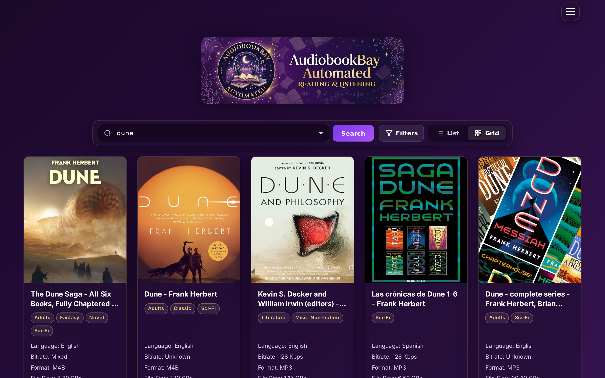
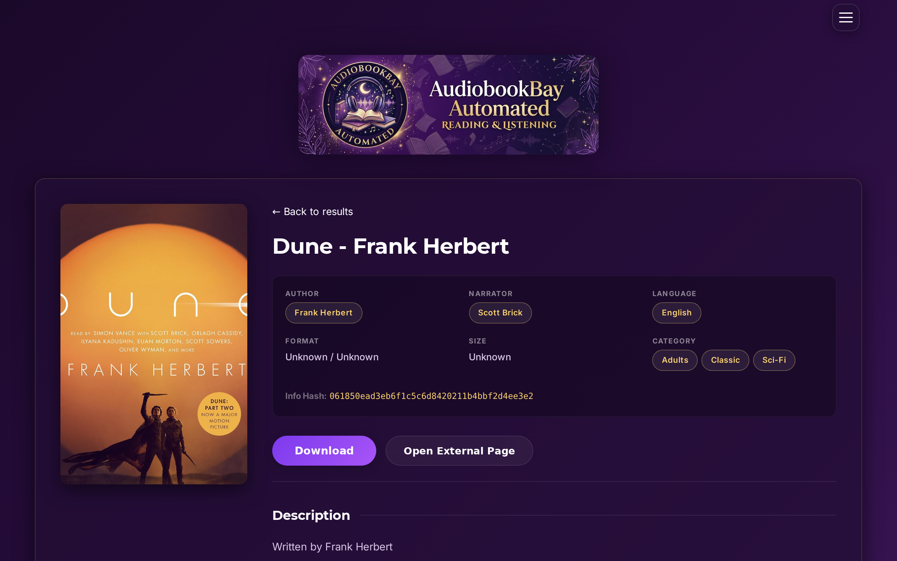
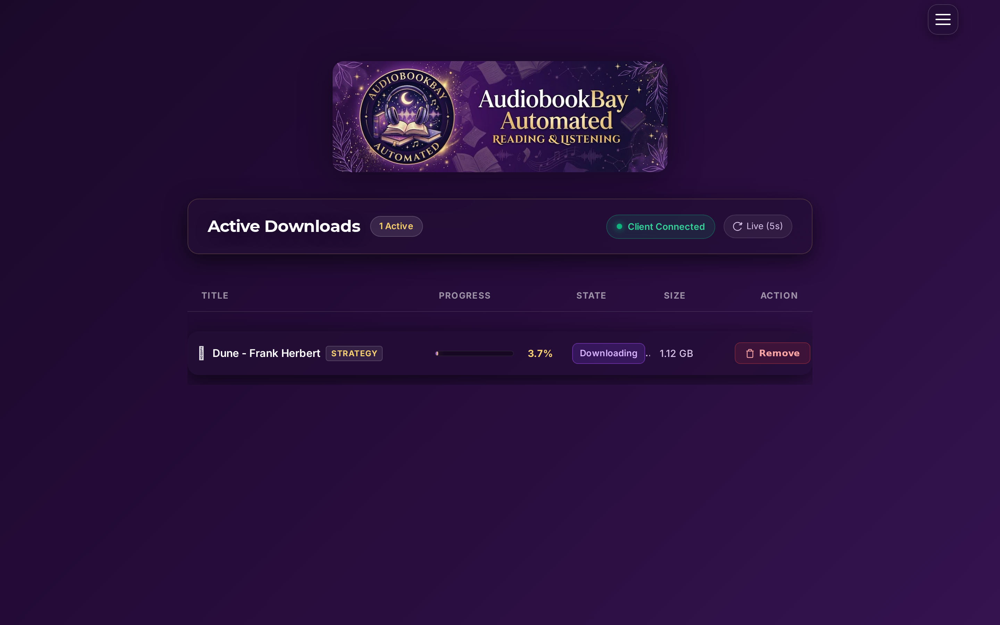

<!-- File: README.md -->

# AudiobookBay Automated

AudiobookBay Automated is an easy-to-use, single-user web application that helps you search for audiobooks on
[**AudioBook Bay**](https://audiobookbay.lu/) and send them straight to your torrent downloader (**qBittorrent,
Transmission, Deluge, or Put.io**) with a single click.

It is designed to be lightweight and user-friendly: it acts as a central search and dispatch bridge between AudioBook
Bay and your torrent client. When deployed alongside a VPN or network proxy (like Gluetun), all scraping requests are
securely routed through your VPN tunnel so your home IP address is never exposed.

---

## How It Works

Think of AudiobookBay Automated as a personal assistant for finding audiobooks:

1. **You Search**: Type a book title, author, or keyword into the search bar.
2. **The App Browses Safely**: The app securely looks up matching books on AudioBook Bay and shows you the title,
   author, cover art, description, and file size.
3. **One-Click Download**: When you find the book you want, click **Download**.
4. **Sent to Your Download Client**: The app instantly builds a magnet link and hands it to your download client (like
   qBittorrent), telling it exactly where to save the files and giving it an organizational label (category).
5. **Ready for Your Player**: Once your torrent client finishes downloading, the files are organized into a folder named
   after the book. If you use [**Audiobookshelf**](https://www.audiobookshelf.org/), you can even trigger a library scan
   right from the navigation menu!

> [!NOTE] **This app does not download audio files or torrent files itself.** It simply finds the book and tells your
> torrent client to download it. Your torrent client does all the heavy lifting of downloading and saving files.

---

## Key Features

- 🔍 **Centralized Search**: Search by title, author, narrator, or keywords across AudioBook Bay mirrors. (When routed
  through a VPN container like Gluetun, your searches remain completely private).
- 🧲 **No AudioBook Bay Account Required**: Automatically turns book hashes into standard magnet links.
- ⚡ **Works With Your Favorite Download Client**: Native support for **qBittorrent**, **Transmission**, **Deluge**, and
  cloud-based **Put.io**. You can even hook up multiple clients at once!
- 📁 **Organized for Audiobookshelf**: Automatically names folders and assigns categories so completed books cleanly
  import into [Audiobookshelf](https://www.audiobookshelf.org/) or any media server.
- 🎨 **14 Built-In Color Themes**: Choose from vibrant modern styles including Purple, Crow, Catppuccin Mocha, Nord,
  Tokyo Night, OLED Black, Dracula, Cyberpunk, and more.
- 🩺 **Built-In Diagnostics**: Live system health dashboard and mirror scraper inspector (`/diagnostics`).
- 📱 **Mobile & Tablet Friendly**: Clean, responsive layout that works on smartphones, tablets, and desktop screens.

---

## Getting Started

### Prerequisites

You only need two things to get started:

1. **A Download Client**: One of the following running on your network or server:
   - **qBittorrent** (WebUI enabled)
   - **Transmission** (RPC/Web enabled)
   - **Deluge** (WebUI enabled — _see tip below_)
   - **Put.io** (cloud account with an API token)
2. **Docker** (recommended for quick setup) or **Python 3.13+** if running directly.

> [!TIP] **For Deluge Users:** Please make sure the **Label** plugin is enabled in your Deluge settings. This allows the
> app to categorize audiobooks and display active downloads on the Status page. (qBittorrent and Transmission support
> categories automatically without extra plugins).

---

## Setup with Docker (Recommended)

The easiest way to run AudiobookBay Automated is with Docker Compose.

### Step 1: Download or Create `docker-compose.yml`

Grab the template from [`examples/docker-compose.env.yaml`](examples/docker-compose.env.yaml) or paste the following
into a file named `docker-compose.yml`:

```yaml
services:
  audiobookbay-automated:
    image: ghcr.io/dtheurer/audiobookbay-automated:latest
    container_name: audiobookbay-automated
    restart: unless-stopped
    ports:
      - "5078:5078"
    env_file:
      - .env
```

### Step 2: Create Your Configuration File (`.env`)

In the same folder as your `docker-compose.yml`, create a `.env` file (you can also copy
[`examples/.env.example`](examples/.env.example)):

```env
# ==========================================
# 1. Download Client Connection (Required)
# ==========================================
DL_CLIENT=qbittorrent
DL_HOST=192.168.1.123
DL_PORT=8080
DL_USERNAME=admin
DL_PASSWORD=your_password

# ==========================================
# 2. Save Location & Security (Required)
# ==========================================
# IMPORTANT: This is the folder path as seen INSIDE your torrent client!
SAVE_PATH_BASE=/downloads/audiobooks

# A random secret string used to protect your web session
SECRET_KEY=change_this_to_a_long_random_string
```

### Step 3: Start the Container

```bash
docker compose up -d
```

Open your browser and navigate to `http://YOUR-SERVER-IP:5078`.

---

## Running Directly with Python (Without Docker)

If you prefer running directly on your server or desktop:

1. **Install Python 3.13 or 3.14**:

   ```bash
   git clone https://github.com/dtheurer/audiobookbay-automated.git
   cd audiobookbay-automated
   pip install .
   ```

2. **Configure your `.env`**:

   ```bash
   cp examples/.env.example .env
   # Edit .env with your favorite text editor
   nano .env
   ```

3. **Start the server**:

   ```bash
   python audiobook_automated/app.py
   ```

---

## Understanding `SAVE_PATH_BASE` (The Most Important Setting!)

The single most common setup question is: _"Where do the audiobooks get saved?"_

> [!IMPORTANT] **`SAVE_PATH_BASE` is the path from the perspective of your download client, NOT this web app.**
>
> When you click **Download**, this app sends a message to your torrent client saying: _"Please save this audiobook in
> `SAVE_PATH_BASE/Author - Book Title/`."_
>
> - **Example**: If your qBittorrent runs in Docker and saves audiobooks to `/data/audiobooks`, you should set:
>   `SAVE_PATH_BASE=/data/audiobooks`
> - If your download client runs directly on Windows and saves to `D:\Audiobooks`, set: `SAVE_PATH_BASE=D:\Audiobooks`
>   and `DL_CLIENT_OS=windows`.

---

## Configuration Reference

Settings are grouped from the simplest everyday options to advanced fine-tuning:

### 1. Essential Settings (Required)

| Setting          | Description                                                                                                 | Example                  |
| ---------------- | ----------------------------------------------------------------------------------------------------------- | ------------------------ |
| `DL_CLIENT`      | Your torrent downloader: `qbittorrent`, `transmission`, `deluge`, or `putio`.                               | `qbittorrent`            |
| `DL_HOST`        | IP address or hostname of your download client.                                                             | `192.168.1.123`          |
| `DL_PORT`        | WebUI port of your download client (Default: 8080 for qBittorrent, 9091 for Transmission, 8112 for Deluge). | `8080`                   |
| `DL_USERNAME`    | WebUI login username.                                                                                       | `admin`                  |
| `DL_PASSWORD`    | WebUI login password (or Put.io API token).                                                                 | `mysecretpassword`       |
| `DL_API_KEY`     | (Optional) Modern API key authentication for qBittorrent or Put.io token.                                   | `my_api_key`             |
| `SAVE_PATH_BASE` | Folder path where files should be stored inside your download client.                                       | `/downloads/audiobooks`  |
| `SECRET_KEY`     | Any random string used to sign browser session cookies.                                                     | `super-secret-key-12345` |

### 2. Optional & Customization Settings

| Setting          | Description                                                                                                                                           | Default                      |
| ---------------- | ----------------------------------------------------------------------------------------------------------------------------------------------------- | ---------------------------- |
| `DEFAULT_THEME`  | Color theme: `purple`, `crow`, `catppuccin`, `nord`, `tokyo`, `oled`, `forest`, `ocean`, `sunset`, `dracula`, `cyberpunk`, `light`, `royal`, `slate`. | `purple`                     |
| `SITE_TITLE`     | Custom title shown in header and browser tab.                                                                                                         | `AudiobookBay Automated`     |
| `SITE_LOGO`      | Custom header logo filename or URL.                                                                                                                   | _(default logo)_             |
| `SPLASH_ENABLED` | Show the animated intro video on first visit (`True` or `False`).                                                                                     | `True`                       |
| `ABS_URL`        | Audiobookshelf server address (enables "Reload Library" button).                                                                                      | `http://192.168.1.123:13378` |
| `ABS_KEY`        | Audiobookshelf API token (Found in: _Settings -> Users -> API Token_).                                                                                | _(none)_                     |
| `ABS_LIB`        | Audiobookshelf Library ID (found in browser URL when viewing library).                                                                                | _(none)_                     |
| `NAV_LINK_NAME`  | Name for an extra quick-link in the menu (e.g. "Open Audiobookshelf").                                                                                | _(none)_                     |
| `NAV_LINK_URL`   | Web address for the custom quick-link.                                                                                                                | _(none)_                     |

### 3. Advanced Settings (For Power Users)

| Setting              | Description                                                                               | Default                           |
| -------------------- | ----------------------------------------------------------------------------------------- | --------------------------------- |
| `DL_CLIENTS`         | Connect multiple clients at once! Comma-separated list (e.g. `qbittorrent,transmission`). | _(single DL_CLIENT)_              |
| `DL_CLIENT_OS`       | Operating system of your download client: `posix` (Linux/Mac) or `windows`.               | `posix`                           |
| `DL_SCHEME`          | Connection protocol to your download client: `http` or `https`.                           | `http`                            |
| `DL_CATEGORY`        | Category label applied to sent downloads.                                                 | `abb-automated`                   |
| `LISTEN_PORT`        | Web port AudiobookBay Automated listens on.                                               | `5078`                            |
| `LISTEN_HOST`        | Network interface to bind to (`0.0.0.0` for all interfaces).                              | `0.0.0.0`                         |
| `PAGE_LIMIT`         | Maximum number of search pages to fetch per query.                                        | `3`                               |
| `ABB_HOSTNAME`       | Primary search mirror.                                                                    | `audiobookbay.lu`                 |
| `ABB_MIRRORS`        | Backup mirrors tried automatically if primary is down.                                    | `audiobookbay.is,audiobookbay.se` |
| `ENABLE_DIAGNOSTICS` | Enable the live `/diagnostics` health check and scraper inspector page.                   | `False`                           |
| `LOG_LEVEL`          | Logging verbosity: `DEBUG`, `INFO`, `WARNING`, `ERROR`.                                   | `INFO`                            |

---

## Audiobookshelf Integration

If you use [Audiobookshelf](https://www.audiobookshelf.org/) to listen to your books:

1. In Audiobookshelf, navigate to **Settings** -> **Users** -> select your user account -> click **API Token**.
2. Copy the token into `ABS_KEY`.
3. Go to your Audiobookshelf audiobooks library page. Look at your browser address bar: the library ID is the text at
   the end of the URL (e.g., `http://server:13378/library/abc123xyz` -> `abc123xyz`). Copy this into `ABS_LIB`.
4. Enter your Audiobookshelf URL into `ABS_URL`.
5. You will now see a **Reload Library** button inside AudiobookBay Automated! Clicking it instantly tells
   Audiobookshelf to scan for your newly downloaded books.

---

## Screenshots

### Search Interface



### Book Details



### Download Status



---

## Feedback & Contributing

Have a question, suggestion, or bug report? Please feel free to open an issue or pull request on GitHub!

**Developers:** Before contributing code, please consult [`AGENTS.md`](AGENTS.md) and the guides in `docs/agents/` for
architectural invariants, strict typing rules, and testing standards.
